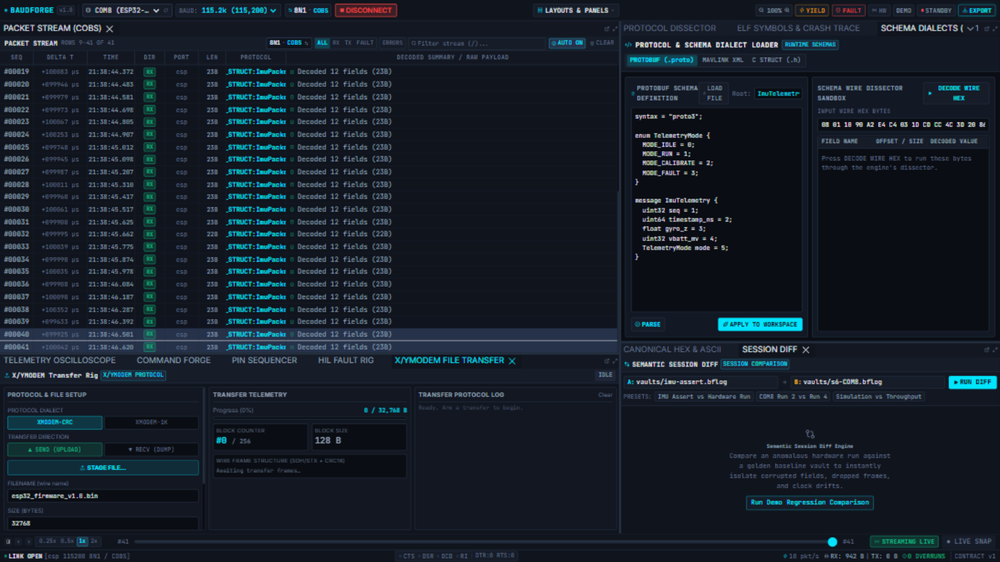

# BaudForge



**BaudForge** is a desktop workstation for embedded firmware engineers, test rigs and
hardware-in-the-loop validation. It consolidates four tools that normally live apart:

1. **Serial monitor & packet stream** — up to 12 Mbaud, sub-microsecond timestamps,
   modem-line status (CTS/RTS/DTR/DSR/DCD/RI), and line / COBS / SLIP / length-prefix
   packet slicing.
2. **Protocol dissector** — wire-level decoding into C structs (parsed from `.h`
   headers), Protobuf, MAVLink XML dialects, CCSDS, CSP and Modbus RTU.
3. **Telemetry oscilloscope** — 60 FPS canvas DSO with per-channel cursors, math
   channels and FFT spectrum, logic rails, and a DVR scrubber over recorded sessions.
4. **Fault rig & pin sequencer** — CRC corruption, frame drops and bit-fuzzing
   triggers, timed GPIO sequences with bootloader-strap macros, and XMODEM/YMODEM
   firmware transfer.

Every session records to an append-only `.bflog` vault with a `.bfidx` index for
instant time-seek, and exports to CSV, JSON Lines, PCAP-NG and Saleae Logic 2.

## Documentation

The user manual is on GitHub Pages:
**[siyal343.github.io/baud-forge](https://siyal343.github.io/baud-forge/)**
(sources in `docs/src`, built by `ui/scripts/build-docs.mjs`).

- [Quickstart & troubleshooting](docs/QUICKSTART.md)
- [Project structure](docs/PROJECT-STRUCTURE.md)
- [Hardware validation](docs/HARDWARE_VALIDATION.md)
- [What the VPS lab is for](docs/VPS-LAB.md)

## Architecture

A Rust workspace of nine crates plus a React workbench:

| Crate | Role |
| --- | --- |
| `bforge-hal` | transports: UART, TCP/UDP sockets, modem lines, hotplug, SIL generator |
| `bforge-framer` | line / COBS / SLIP / length-prefix framing, CRC-8/16/32 |
| `bforge-dissect` | C-header, Protobuf, CCSDS, CSP, MAVLink, Modbus RTU dissection |
| `bforge-elf` | ELF/DWARF symbols, `defmt` & `pw_tokenizer` tokens, backtrace resolution |
| `bforge-script` | sandboxed Rhai transform scripts on the send/receive path |
| `bforge-storage` | `.bflog` vaults, `.bfidx` seek index, exporters |
| `bforge-core` | SPMC pipeline, sessions, fault injection, HTTP/SSE contract |
| `bforge-cli` | headless engine & `bforge` CLI (`serve`, `record`, `replay`, `diff`, `assert`, `xfer`) |
| `bforge-desktop` | Tauri v2 desktop shell hosting the workbench |

The UI (`ui/`) is React 19 + TypeScript + Vite + Tailwind + Dockview, driven by a
Zustand workstation store.

## Building from source

Prerequisites: Rust 1.85+ (edition 2024), Node 20+, pnpm.

```sh
# workbench UI
cd ui && pnpm install && pnpm run build

# headless engine & CLI
cargo build -p bforge-cli --release

# desktop application
cargo build -p bforge-desktop --release
```

Tests: `cargo test --workspace`, and `pnpm test` + `pnpm smoke` in `ui/`.

## Try it

- `examples/*.lua` — Rhai transform scripts (drop every third frame, flip the last
  byte, uppercase on receive)
- `examples/*.bforge.toml` — launcher profiles for the loopback and ESP32 demos
- `firmware/` — Arduino test firmware that streams telemetry for the demo loop
- `dashboards/` — declarative XML dashboards (battery BMS, motor diagnostics)

`specs/` holds the numbered feature specifications the code and tests reference;
each feature lands with a spec, and commit messages cite the numbers.

## License

Dual-licensed under [MIT](LICENSE-MIT) or [Apache-2.0](LICENSE-APACHE), at your option.
