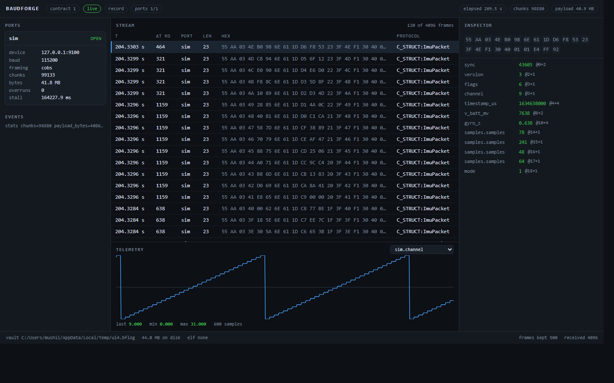

# BaudForge 0.3.0

Deferred-link faults. Everything in 0.2.1, plus latency on the wire and scripts on what
arrives — the two halves of a rig that FR-FLT-01 and FR-SCR-01 ask for. Released
31 October 2026.

## New since 0.2.1

- **Latency as a fault** (spec 0033). `{"kind":"delay","delay_ms":300}` holds every
  transmitted frame 0–5000 ms. The reader holds it, so the deadline never blocks a read,
  and the send answers at once with `delay_ms` — accepted is not delivered.
- **Receive-side scripts** (spec 0033). `rx_script_path` runs a Lua hook on arriving bytes
  **before** the vault and the decoder, so a host can be made to see what a test needs it
  to see. `examples/uppercase-on-receive.lua` is the worked example.
- **The same sandbox both ways**: no `io`, no `os`, no clock, 200 000 instructions per
  call, and a failing call passes bytes through rather than stopping the session.

## Measured

| Claim | Figure |
| --- | --- |
| Delay | a 300 ms hold answered the send in < 150 ms and the device received `01 02 03` ≥ 250 ms later |
| Receive script | device sent `hello 7`, the decoder saw `HELLO 7` |
| Tests | 259, 10 of them in the serve path |

## Recorded, not hidden

A delayed frame does not survive a reconnect (D-92), the delay is fixed rather than a
random span (D-91), and a vault recorded under a receive script is a record of what the
engine *decoded*, not what the device sent.

# BaudForge 0.2.1

Polish release. Everything in 0.2.0, plus an installer and a fix to one dishonest
silence. Released 31 October 2026.

## New since 0.2.0

- **A Windows installer.** `BaudForge_0.2.1_x64-setup.exe`, built by Tauri's NSIS
  bundler: it installs the window and the workbench into `%LOCALAPPDATA%` and adds a
  Start-menu entry. CI builds it on every push (`desktop (windows)`) and attaches it to
  every release tag.
- **The workbench says when it is showing a sample.** The engine drops a frame batch
  that a client has not read, because a slow client must not stall the pump. That was
  silent: a 200 Hz capture showed about two frames per second in the browser while the
  vault held all 164 073. The footer now says `sampled: N batch(es) not shown` in the
  warning colour (D-81).
- **The desktop crate moved into the Tauri layout** (`crates/bforge-gui/src-tauri`), so
  `tauri build` and `tauri bundle` work from a clean checkout. That was the only thing
  standing between the project and an installer.

## Measured

| Claim | Figure |
| --- | --- |
| Installer | `BaudForge_0.2.1_x64-setup.exe`, 2.40 MiB, `FileVersion 0.2.1` |
| Release build | 8 min from clean, 1 min 50 s incremental |
| Test suite | 256 tests |

# BaudForge 0.2.0

Second release. Everything in 0.1.0, plus a programmable fault path and a typed command
path. Released 31 October 2026; the figures below were measured on this machine.

## New since 0.1.0

- **Lua fault scripts** (spec 0031). A sandboxed Lua 5.4 hook runs on every transmitted
  frame: it may change the bytes or drop the frame. No `io`, no `os`, no clock, and a
  200 000-instruction budget per call, so an infinite loop costs one frame. Example
  scripts ship in `examples/`.
- **Typed encoding** (spec 0032). `POST /api/send` accepts `values` and encodes them with
  the port's own C header schema — one table read and written, so a form and a decoder
  cannot drift. Omitted fields stay zero; an unknown name is refused, never sent as zeros.
- **The forge has a typed mode** (spec 0032). One row per numeric leaf of the last decoded
  frame, seeded with the values that frame carried.
- **Enums by label** (spec 0032). `MODE_FAULT`, `mode_fault` and `2` are the same frame; a
  label the enum does not carry is refused with both names.
- **Real headers work unedited** (spec 0032). A field may be an enum through a typedef
  (`state_t state;`) and a struct inside a struct is addressable as `gains.proportional`.
- **A bridge posts instead of waiting** (spec 0030), and rows carry a direction
  (spec 0028) so a bridged pair reads as one bus (spec 0029).

## What the C-compiler block cost, and why it is gone

Tree-sitter (D-35) and the script runtime were both deferred because this machine had no C
compiler. The MSVC toolchain installed for the desktop shell provides `cl.exe`, and the
vendored Lua 5.4 builds with it. The GNU toolchain here still has no compiler, so a local
GNU build needs `--exclude bforge-script`; every CI runner has one.

## Measured for 0.2.0

| Claim | Figure |
| --- | --- |
| Test suite | 255 tests, ~25 s |
| Script runtime | 8 tests: flip, drop, nonsense return, infinite loop, no `io`, missing hook, label cases |
| Typed send | `{"sync":43605,"mode":"MODE_FAULT"}` → `{"sent":7}`, device received the bytes the decoder reads back |
| Nested struct | `gains.proportional` encoded and decoded through the same IR |
| CI | 9 jobs green on 6 targets, including the Windows desktop build |

## Still not in it

The list from 0.1.0 stands, less what this release closed:

- no installer or signing (D-74, deferred by decision);
- no jitter or latency injection (D-66), no script on the receive path (D-84);
- scripts work in bytes, not dissected fields (D-83);
- plots are SVG, one series (D-63); the inspector is flat (D-69);
- the scrubber seeks by record, not time (D-68); no live transmit rows (D-79);
- enums are four bytes, so a short-enum firmware needs the width (D-89);
- an array of structs is not expanded (D-90);
- Windows is the only desktop platform that was built and run (D-77).

# BaudForge 0.1.0

First release candidate. A serial monitor, a protocol dissector and a fault-injection
rig for one machine or two sockets, with a workbench that runs in a browser or in a
window.

Released 30 October 2026. Everything below was run and measured on this machine; the
numbers say what they measured and nothing more.

## What is in it

**Engine**

- One reader thread per port, fixed-size rings, a disk logger that never drops a byte.
- Transports: serial (USB identity or device path), TCP client, TCP server, UDP.
- Framing: delimiter, COBS, SLIP, Intel HEX, sync word plus length, idle gap.
- Checksums: CRC-8/ATM, CRC-16/CCITT-FALSE, CRC-32C, verified against published vectors.
- Vault: `.bflog`, 256-byte header, 32-byte records, a persisted sparse index, repair of
  a killed session.
- Hotplug: a port that disappears is reopened in the same session, with a cumulative
  attempt budget.
- Yield: the engine hands the port to a flash tool for a window and takes it back.
- Dissectors: a C header parser (packed structs, bitfields, enums, arrays, endianness)
  and three native packs (CCSDS TM/TC with PUS, CSP v1, Modbus RTU).
- Symbols: an address in a frame becomes a function and a source line.
- Send path with `crc8`, `crc16` and `crc32c` appended on the wire.
- Fault profiles: bit flips, dropped bytes, truncation, corrupted CRC, seeded so a run
  reproduces.
- Bridges: a passive tap or an inline forward between two ports, recording the forwarded
  copy as transmit.

**Workbench** (browser or desktop window)

- Ribbon with link, contract, mode, ports and counters.
- Port cards with state, chunks, bytes, overruns and stall time.
- Live stream with direction, hex, protocol and crash badges.
- Inspector with the decoded fields, and the bytes a field came from lit on hover.
- One telemetry plot, from the live stream or from a scrubbed window.
- Scrubber over a vault, with the plot following the window.
- Command forge and a fault injector beside it.
- Paired bus view for a bridge's two ports, merged by time.

**Command line**

`help`, `version`, `config check`, `ports list`, `record`, `replay`, `status`, `serve`,
`tail`, `assert`, `vault info`, `vault repair`, `yield`.

## Found and fixed during the release pass

Two bugs that only a real capture could show. Both are fixed here, with tests.

1. **`bforge assert` never finished on a real capture.** The reader walked forward
   from the sparse index for *every* record, so a window cost `count × stride`
   reads and a whole-vault decode was quadratic. On the 14.6 MB capture from the
   board, `assert` ran over ten minutes without finishing; after the fix it reads
   327 929 chunks, decodes 164 073 frames and answers in **10 s**.
2. **A session truncated an existing vault.** `serve --vault demo.bflog` opened the
   same path for writing and destroyed the capture that was already there. A
   session now refuses a non-empty vault and says so; an empty file is allowed.

## Measured on this machine

| Claim | Figure |
| --- | --- |
| Pipeline, four ports, 60 s | 288 MB, 0 gaps, 11.9 MiB peak |
| Vault read, 512 MiB file | 21.5 MiB peak (4.2 % of the file) |
| COBS framing | 2000 frames, 156 MB/s, 0 invalid |
| C header dissection | 180 422 frames/s |
| Symbol lookup | 1.2 µs per address |
| Hotplug, three unplugs | detected in 16.8 / 24.9 / 47.1 ms, reopened in 1 ms |
| Flash while recording | `arduino-cli upload` wrote 298 880 bytes during a yield |
| ESP32-C3 on COM8, 15 minutes of `mode imu` at `rate 200` | 327 929 chunks, 4 101 333 payload bytes, 164 073 frames, 0 overruns, 0 read errors |
| The same capture through `assert` | 3 of 3 checks in 10 s; every frame `C_STRUCT:ImuPacket`, `mode = RUN` |
| Fault injection on hardware | `bit_flip` at 1.0 reported `fault_bytes: 3` for a 3-byte command |
| Desktop window | title `BaudForge`, engine on a random loopback port, recorded 2308 records |
| Test suite | 234 tests, 20 s |

## How to run it

`docs/QUICKSTART.md`, three ways: two simulated devices, an ESP32-C3, or the desktop
window.

## Not in this release

These are deliberate, recorded in `DEFERRED.md` with the reason and the unblocking
condition:

- no installer or code signing (D-74, deferred to a later release by decision);
- no Lua fault scripts (D-67), no jitter or latency injection (D-66);
- plots are SVG, one series, not WebGL at 60 FPS (D-63);
- the inspector is a flat field list, not a tree (D-69);
- the command forge takes hex, not typed fields (D-64);
- the scrubber seeks by record, not wall-clock time (D-68);
- no live transmit rows: a bridge's writes appear in a scrubbed window (D-79);
- no protobuf, Kaitai, defmt or MAVLink (D-35, D-56);
- Windows is the only desktop platform that was built and run (D-77).

## A note about the demo capture

The 15-minute capture from the board was destroyed by the second bug above, before it
was fixed, and the board is no longer attached to this machine for a re-run. The
figures were measured on that capture before it was lost; the numbers are real, the
file is not.

## Upgrading

Nothing to upgrade from. The vault format is version 1; if it changes, the header says
so and `bforge vault info` reports it.
