# BaudForge Feature User-Flow Diagrams (Brainstorm)

**Date:** 2026-11-16  
**Source:** Panel catalog in [`ui/src/components/GlobalRibbon.tsx`](ui/src/components/GlobalRibbon.tsx#L40-L56) (`PANEL_CATALOG`, 15 panels across 3 tiers) + Launcher / DVR / Flash Yield.

This document maps how a user actually enters, operates, and exits each BaudForge feature so we can spot friction, redundant steps, and onboarding gaps.

---

## 0. Master Entry & Session Lifecycle (Launcher, Flash Yield, DVR, Vaults)

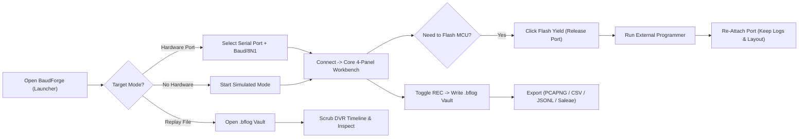

---

## 1. Core Daily Workbench (Tier 1)

### 1.1 Packet Stream (`packetStream`)
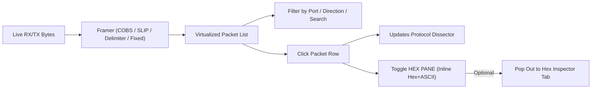

### 1.2 Protocol Dissector (`protocolDissector`)
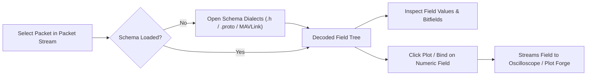

### 1.3 Telemetry Oscilloscope (`oscilloscope`)
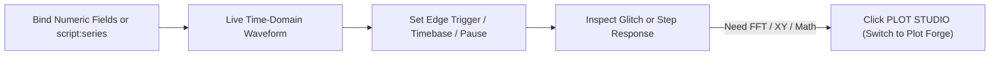

### 1.4 Command Forge (`commandForge`)
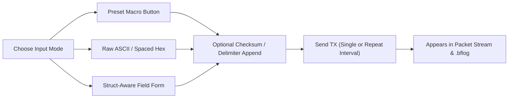

---

## 2. Telemetry, Hex & Symbols (Tier 2)

### 2.1 Plot Forge (`plotForge`)
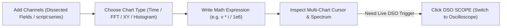

### 2.2 Canonical Hex & ASCII (`hexInspector`)
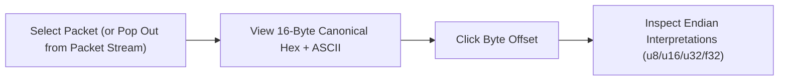

### 2.3 Schema Dialects (`schemaDialects`)
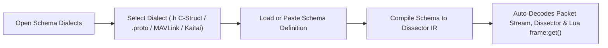

### 2.4 ELF Symbol & Crash Trace (`elfSymbols`)
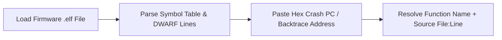

### 2.5 Session Diff & Comparison (`sessionDiff`)
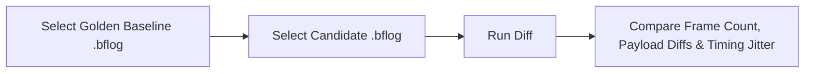

---

## 3. HIL, Scripting & Specialist (Tier 3)

### 3.1 Lua 5.4 Script Lab (`scriptLab`)
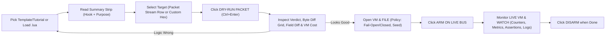

### 3.2 HIL Fault Injection Rig (`faultRig`)
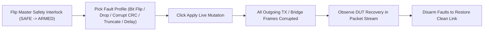

### 3.3 Pin Sequencer & Modem Lines (`pinSequencer`)
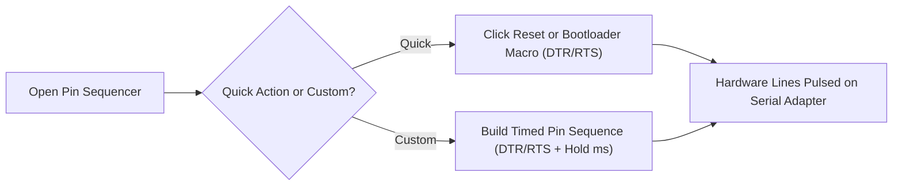

### 3.4 X/YMODEM File Transfer (`fileTransfer`)
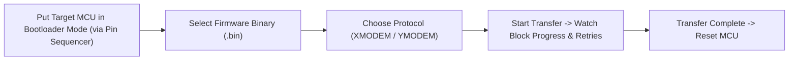

### 3.5 MITM Bridge & Relay (`bridge`)
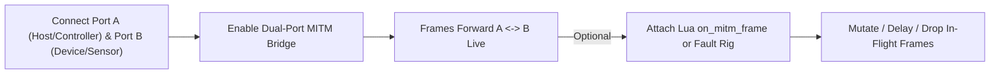

### 3.6 Activity Log (`activityLog`)
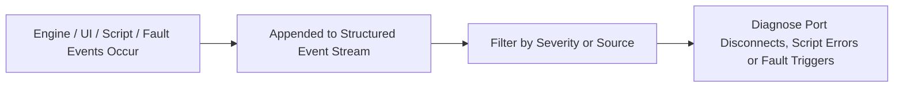

---

## 4. Placement & Overlap Analysis

### 4.1 Where These Diagrams Benefit Most
- **Best Primary Home — Docs Site (`docs/src/workflows.md` -> `docs/site/workflows.html`):**
  - The docs site currently documents each of the 20+ panels in isolation, but new users need **task-based end-to-end flows** (*"Which panels do I use together to flash an MCU, debug a binary struct, or test fault recovery?"*).
  - Linking `workflows.html` from `index.html` and from individual panel pages gives users the big picture without adding weight to the desktop app.
- **Keep the App UI Lightweight:**
  - Avoid embedding a heavy diagram viewer inside the dockable workbench (which was already streamlined from 13 panels down to 4 in `PRODUCT_BLOAT_AND_USAGE_ANALYSIS.md`).
  - Instead, keep **in-app guidance local and minimal**: concise `HOW IT WORKS` strips inside complex panels (like `ScriptLabView.tsx`) plus a `? Docs` link to the docs site.

### 4.2 Observed Flow Overlaps & Concrete Suggestions
1. **`Oscilloscope` (`3,588` LOC) vs `Plot Forge` (`2,926` LOC):**
   - *Overlap:* Both start with *"Bind Dissected Fields or `script:series` -> Inspect Graph"* and share `PlotEngine`.
   - *Suggestion:* Long-term, merge into one **Plotter** panel with mode tabs (`Live Scope` | `FFT / XY / Math`) to remove "which plotter?" ambiguity and cut ~2,500+ UI LOC. Short-term, keep the `PLOT STUDIO` / `DSO SCOPE` toggle buttons prominent.
2. **`HIL Fault Rig` (`360` LOC) vs `Lua Script Lab` (`1,126` LOC):**
   - *Overlap:* Both inject bit-flips, drops, CRC errors, and delays.
   - *Suggestion:* Position `Fault Rig` as **No-Code TX Faults** and `Script Lab` as **Programmable RX/TX/MITM Logic**. Either demote `QUICK FAULTS` in `ScriptLabView` to a simple `Fault Rig ↗` link or label it clearly as non-Lua TX shortcuts.
3. **`Hex Inspector` (`482` LOC) standalone vs `Packet Stream` inline `HEX PANE`:**
   - *Overlap:* Users almost always enter hex inspection by clicking a row in `Packet Stream`.
   - *Suggestion:* Keep `Hex Inspector` as a pop-out target from `Packet Stream` rather than a primary workflow entry.
4. **Add 3 Goal-Oriented "Recipe Flows" to Docs & Layout Presets:**
   - **Recipe A — Bring-Up & Flash:** `Pin Sequencer` (Bootloader) -> `X/YMODEM` or `Flash Yield` -> `Pin Sequencer` (Reset) -> `Packet Stream`.
   - **Recipe B — Binary Telemetry Debug:** `Schema Dialects` (`.h`) -> `Packet Stream` + `Protocol Dissector` -> `Oscilloscope` / `Plot Forge`.
   - **Recipe C — Fault & Crash Triage:** `Fault Rig` / `Script Lab` + `MITM Bridge` -> `Packet Stream` -> `ELF Symbols` (resolve crash PC).

