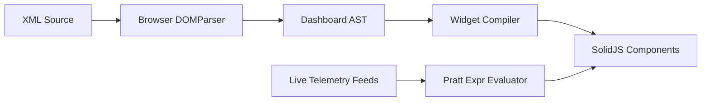

# Reconfigurable Instrumentation UI & Declarative Dashboard Architecture

This document specifies the technical architecture for the user-reconfigurable workbench in BaudForge.

## 1. Overview

The BaudForge workbench must support flexible hardware and protocol engineering environments.
Users can:
1. Reorganize screen real estate through a dock tree engine.
2. Select visual themes, typography scales, and row density tiers.
3. Show, hide, reorder, and resize stream table columns.
4. Customize global keyboard shortcuts.
5. Build custom engineering dashboards using declarative XML and expression binding.
6. Pop out panels into separate windows across multiple monitors.

---

## 2. Component Architecture

```mermaid
graph TD
    subgraph State Management
        Store["ui/src/lib/store.ts<br/>(Live frames, timeline, ports, selection)"]
        Settings["ui/src/lib/settings.ts<br/>(User layouts, theme, density, columns)"]
        Commands["ui/src/lib/commands.ts<br/>(Action dispatcher & hotkeys)"]
    end

    subgraph Dock System
        DockTree["ui/src/lib/dock/tree.ts<br/>(Pure functional split-tree operations)"]
        DockContainer["ui/src/components/dock/DockContainer.tsx"]
        DockSplitter["ui/src/components/dock/DockSplitter.tsx"]
        DockStack["ui/src/components/dock/DockStack.tsx"]
        DropOverlay["ui/src/components/dock/DropOverlay.tsx"]
    end

    subgraph Panel Modules
        HardwareBay["panels/HardwareBayPanel.tsx"]
        StreamView["panels/StreamPanel.tsx"]
        HexInspector["panels/InspectorPanel.tsx"]
        Oscilloscope["panels/TelemetryPanel.tsx"]
        Console["panels/ConsolePanel.tsx"]
        Dashboard["panels/DashboardPanel.tsx"]
        SessionDiff["panels/SessionDiffPanel.tsx"]
    end

    subgraph Dashboard Engine
        XMLParser["dashboard/parser.ts (DOMParser)"]
        ExprParser["dashboard/expr.ts (Pratt Parser)"]
        Widgets["dashboard/widgets/ (*.tsx)"]
    end

    Store --> Panel Modules
    Settings --> Dock System
    Commands --> Settings
    DockSystem --> Panel Modules
    DashboardEngine --> Dashboard
```

---

## 3. Pure Dock Engine Specification

### 3.1 Data Structures

The dock engine stores panel layouts as an immutable tree in [`ui/src/lib/dock/types.ts`](file:///f:/Datapack/Personal/Programa/baud-forge/ui/src/lib/dock/types.ts):

```typescript
export type DockDirection = 'horizontal' | 'vertical';

export type DropZone = 'left' | 'right' | 'top' | 'bottom' | 'center';

export interface DockSplitNode {
  type: 'split';
  id: string;
  direction: DockDirection;
  ratio: number; // 0.1 to 0.9, default 0.5
  first: DockNode;
  second: DockNode;
}

export interface DockStackNode {
  type: 'stack';
  id: string;
  tabs: string[]; // List of panel IDs
  activeTab: string;
}

export type DockNode = DockSplitNode | DockStackNode;

export interface DockPanelDefinition {
  id: string;
  title: string;
  icon: string;
  closeable?: boolean;
  allowPopout?: boolean;
}
```

### 3.2 Pure Tree Operations

All tree manipulations return new tree instances without mutating existing nodes:
- `splitNode(tree, targetNodeId, newPanelId, direction, side)`: Converts a target leaf stack into a split node with two branches.
- `addTabToStack(tree, targetStackId, newPanelId)`: Appends a panel ID to an existing tab stack.
- `removePanel(tree, panelId)`: Prunes the panel from its stack. If the stack becomes empty, the tree collapses the parent split node.
- `updateSplitRatio(tree, splitId, ratio)`: Updates the relative size ratio between two split branches.
- `movePanel(tree, sourcePanelId, targetStackId, zone)`: Moves a panel from any source location into a new target zone.

### 3.3 Drag and Drop Visual Feedback

When dragging a panel tab:
1. The user drags a tab header.
2. An overlay activates across valid dock targets.
3. The pointer position calculates the target zone:
   - Outer 20% left: split left.
   - Outer 20% right: split right.
   - Outer 20% top: split top.
   - Outer 20% bottom: split bottom.
   - Center 60%: tab stack.
4. A phosphor blue indicator (`rgba(6, 182, 212, 0.25)`) previews the dock location.
5. Dropping the pointer commits the tree transformation.

---

## 4. Appearance, Columns & Keyboard Commands

### 4.1 Themes & Design Tokens

BaudForge defines three engineering themes in [`ui/src/index.css`](file:///f:/Datapack/Personal/Programa/baud-forge/ui/src/index.css):

| Token Name | `carbon-dark` (Default) | `paper-light` | `high-contrast` |
| :--- | :--- | :--- | :--- |
| `--surface-canvas` | `#090a0d` | `#f4f5f7` | `#000000` |
| `--surface-primary` | `#101217` | `#ffffff` | `#000000` |
| `--surface-card` | `#161920` | `#ebedf0` | `#121212` |
| `--border` | `#1f2430` | `#d0d5dd` | `#ffffff` |
| `--text-primary` | `#e2e8f0` | `#0f172a` | `#ffff00` |
| `--text-secondary` | `#94a3b8` | `#475569` | `#00ffff` |
| `--sig-rx` | `#10b981` | `#059669` | `#00ff00` |
| `--sig-tx` | `#06b6d4` | `#0284c7` | `#00ffff` |
| `--sig-warn` | `#f59e0b` | `#d97706` | `#ff8800` |
| `--sig-fault` | `#f43f5e` | `#dc2626` | `#ff0000` |

### 4.2 Row Density Tiers

Virtual stream row heights and typography scale dynamically:

- **Compact:** 22 px row height, 11 px font, 3 px cell padding. Ideal for high packet rates and dense traces.
- **Default:** 26 px row height, 12 px font, 5 px cell padding. Balanced for standard 1080p and 1440p displays.
- **Spacious:** 32 px row height, 13 px font, 8 px cell padding. Ideal for 4K displays and touch interfaces.

The virtual stream table binds its item measurement to the active density setting.

### 4.3 Configurable Stream Columns

Column settings are persisted in `ui/src/lib/columns.ts`:

```typescript
export interface ColumnDefinition {
  id: string;
  label: string;
  width: number;
  minWidth: number;
  visible: boolean;
  fixed?: boolean;
}
```

Users can drag column headers to reorder them and toggle column visibility in the table settings dropdown.

### 4.4 Centralized Keyboard Commands

All hotkeys route through [`ui/src/lib/commands.ts`](file:///f:/Datapack/Personal/Programa/baud-forge/ui/src/lib/commands.ts). Default hotkeys:
- `Ctrl+K`: Open command palette.
- `/`: Focus stream search filter.
- `Space`: Pause or resume DVR playback.
- `Alt+1` to `Alt+4`: Select layout presets.
- `Ctrl+Shift+D`: Toggle session diff view.
- `Esc`: Close open modal or clear search.

---

## 5. Declarative XML Dashboard Engine

### 5.1 Architecture

The dashboard engine allows engineers to define interactive telemetry instruments without writing JavaScript code.



### 5.2 Expression Language (Pratt Parser)

Expressions evaluate safe arithmetic, comparison, and signal extraction without `eval()`:
- Variable access: `rx.voltage`, `fields.rpm`, `stats.rx_overruns`.
- Arithmetic: `+`, `-`, `*`, `/`, `%`.
- Bitwise: `&`, `|`, `^`, `<<`, `>>`.
- Comparisons: `==`, `!=`, `<`, `<=`, `>`, `>=`.
- Built-in math: `min(a, b)`, `max(a, b)`, `abs(x)`, `clamp(val, low, high)`.

### 5.3 Widget Catalog

The dashboard engine provides eight standard widgets:
1. `<gauge>`: Radial or linear meter with configurable green, warning, and fault zones.
2. `<numeric-display>`: Large 7-segment or monospaced digital readout with engineering units.
3. `<chart>`: Real-time scrolling sparkline or strip chart with configurable time window.
4. `<led>`: Bi-color or multi-state status indicator with pulse animation.
5. `<switch>`: Two-position toggle bound to hardware pins or protocol parameters.
6. `<button>`: Command trigger for packet transmission or fault injection.
7. `<slider>`: Continuous numeric parameter control.
8. `<log-grid>`: Filtered telemetry log display.

### 5.4 XML Schema & Validation

The XML format validates against [`schemas/bforge-dashboard-v1.xsd`](file:///f:/Datapack/Personal/Programa/baud-forge/schemas/bforge-dashboard-v1.xsd).

---

## 6. Execution Plan & Task Breakdown

### Subagent Team 1: Layout & Docking
- Implement dock types, pure tree operations, and default layout presets.
- Build dock container, splitter bars, tab stacks, and drag-and-drop indicator overlays.

### Subagent Team 2: Panels & Modularization
- Split [`ui/src/App.tsx`](file:///f:/Datapack/Personal/Programa/baud-forge/ui/src/App.tsx) into isolated panel components in [`ui/src/components/panels/`](file:///f:/Datapack/Personal/Programa/baud-forge/ui/src/components/panels/).
- Create [`ui/src/lib/store.ts`](file:///f:/Datapack/Personal/Programa/baud-forge/ui/src/lib/store.ts) to share reactive state.

### Subagent Team 3: Appearance, Columns & Commands
- Implement theme and density management with CSS custom properties.
- Implement dynamic column configuration in the stream table.
- Build the command registry and settings modal.

### Subagent Team 4: Declarative XML Dashboard
- Implement zero-dependency XML parser and Pratt expression evaluator.
- Create reactive instrument widgets and dashboard view component.
- Write sample dashboard files and XML schema.
