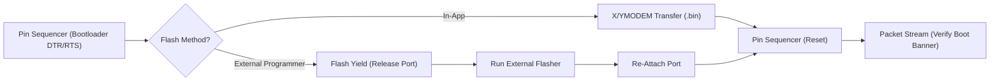
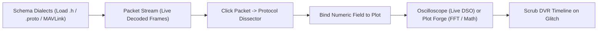
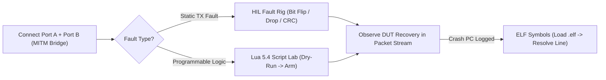
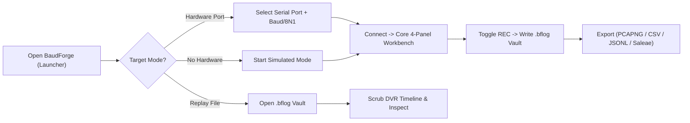
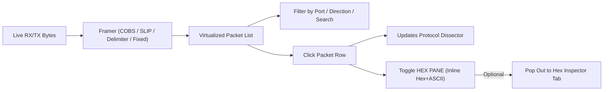
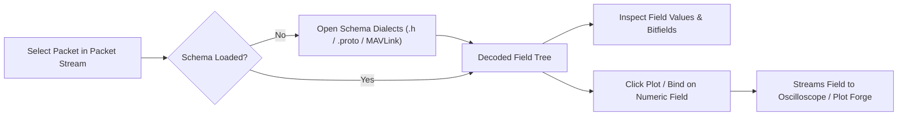
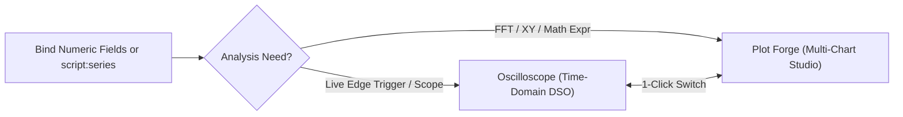
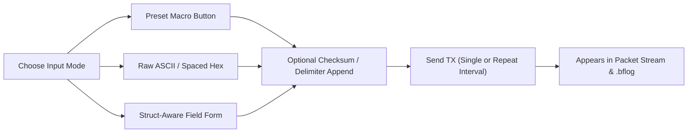
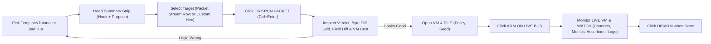
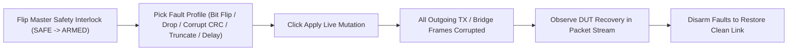

# Workflows & User Flows

BaudForge combines 15 specialized panels around a 4-panel daily core. Use the **3 Recipe Flows** below to see which panels work together for common engineering tasks, or browse the individual panel flows.

---

## Recipe Flows (Goal-Oriented)

### Recipe A: MCU Bring-Up & Firmware Flash

### Recipe B: Binary Telemetry & Signal Debug

### Recipe C: HIL Fault Injection & Crash Triage

---

## Master Session Lifecycle

---

## Core Daily Workbench

### [Packet Stream](packet-stream.html)

### [Protocol Dissector](protocol-dissector.html)

### [Telemetry Oscilloscope](oscilloscope.html) & Plot Forge

### [Command Forge](command-forge.html)

---

## Telemetry, Hex & Symbols

- **[Canonical Hex & ASCII](hex-inspector.html):** Pop out from Packet Stream `HEX PANE` -> click any byte offset -> inspect `u8`/`u16`/`u32`/`f32` interpretations.
- **[Schema Dialects](schema-dialects.html):** Choose `.h` / `.proto` / MAVLink / Kaitai -> load or paste -> compile to Dissector IR -> auto-decodes Packet Stream, Dissector, and Lua `frame:get()`.
- **[ELF Symbols](elf-symbols.html):** Load firmware `.elf` -> paste hex crash PC -> resolve function name and `file:line`.
- **[Session Diff](session-diff.html):** Pick golden `.bflog` + candidate `.bflog` -> compare frame counts, payload diffs, and timing jitter.

---

## HIL, Scripting & Specialist

### [Lua 5.4 Script Lab](script-lab.html)

### [HIL Fault Injection Rig](fault-rig.html)

### [Pin Sequencer](pin-sequencer.html), [X/YMODEM](file-transfer.html), [MITM Bridge](mitm-bridge.html) & [Activity Log](activity-log.html)
- **Pin Sequencer:** Click `Reset` / `Bootloader` macro or build timed `DTR`/`RTS` sequence -> pulses serial adapter lines.
- **X/YMODEM Transfer:** Enter bootloader -> select `.bin` -> choose XMODEM/YMODEM -> watch block progress -> reset MCU.
- **MITM Bridge:** Connect Port A + Port B -> enable bridge -> frames forward `A <-> B` live (optionally attach Lua `on_mitm_frame` or Fault Rig).
- **Activity Log:** Filter structured engine/UI/script/fault events by severity or source to diagnose disconnects or script errors.
