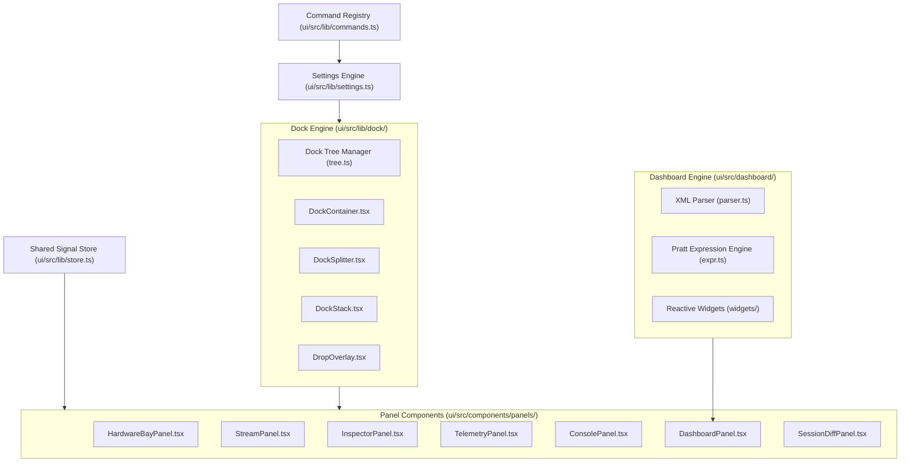

# 0059 — User-Reconfigurable Instrumentation UI & Declarative Dashboard Engine

Status: proposed (2 November 2026).

## Problem

The workbench layout is fixed in code ([`ui/src/App.tsx`](file:///f:/Datapack/Personal/Programa/baud-forge/ui/src/App.tsx)). Users cannot adapt the workspace to their physical hardware setup.
Different engineering workflows require different screen layouts:
- Hardware bring-up requires prominent pin controls and packet feeds.
- Protocol debugging requires synchronized hex dumps, protocol trees, and stream tables.
- Hardware-in-the-loop (HIL) testing requires telemetry plots and custom gauge dashboards.
- Multi-monitor setups require detached panels in separate desktop windows.

Furthermore, stream table columns are fixed, theme and density cannot change, shortcuts cannot be rebound, and custom instrument panels cannot be created without editing TypeScript code.

## Requirements

1. **Dock Engine:**
   - Implement an in-house dock tree in SolidJS with zero external dependencies.
   - Support horizontal splits, vertical splits, and tab-stacked panels.
   - Implement drag-and-drop docking with 5-zone drop indicators (left, right, top, bottom, center-tab).
   - Support pointer-captured splitters with real-time resizing.
   - Support panel pop-out to separate browser or Tauri windows.

2. **Layout Presets & Persistence:**
   - Supply built-in layout presets: "Bring-up", "Protocol Debug", "Telemetry & Oscilloscope", "Minimal Stream".
   - Persist user layouts and customizations in `localStorage`.
   - Support export and import of workspace settings as JSON files.
   - Support workspace layout defaults declared in the `[ui]` section of [`.bforge.toml`](file:///f:/Datapack/Personal/Programa/baud-forge/.bforge.toml).

3. **Appearance & Density:**
   - Support three visual themes: `carbon-dark` (industrial dark), `paper-light` (lab notebook light), and `high-contrast` (black/yellow accessibility).
   - Support three row density modes: `compact` (22 px row, 11 px font), `default` (26 px row, 12 px font), `spacious` (32 px row, 13 px font).
   - Synchronize virtualizer row height with active density mode.

4. **Configurable Stream Table:**
   - Enable users to show, hide, reorder, and resize columns.
   - Supported columns: `index`, `time`, `port`, `dir`, `kind`, `delta`, `payload`, `hex`, `ascii`, `protocol`, `symbol`.

5. **Rebindable Keyboard Shortcuts:**
   - Centralize all application actions into a unified command registry.
   - Enable users to customize keybindings with conflict detection.

6. **Declarative XML Dashboard Engine:**
   - Implement an XML dashboard specification with zero external dependencies using the browser [`DOMParser`](file:///f:/Datapack/Personal/Programa/baud-forge/ui/src/dashboard/parser.ts).
   - Implement an in-house Pratt expression evaluator for telemetry data and computed metrics.
   - Provide engineering widgets: `<gauge>`, `<led>`, `<numeric-display>`, `<chart>`, `<switch>`, `<button>`, `<slider>`, and `<log-grid>`.
   - Publish the formal schema to [`schemas/bforge-dashboard-v1.xsd`](file:///f:/Datapack/Personal/Programa/baud-forge/schemas/bforge-dashboard-v1.xsd).

## Architecture



### 1. Pure Dock Tree Engine

The docking state is represented as a recursive binary split tree or leaf stack:

```typescript
export type SplitDirection = 'horizontal' | 'vertical';

export interface DockSplitNode {
  type: 'split';
  id: string;
  direction: SplitDirection;
  ratio: number; // 0.1 to 0.9
  first: DockNode;
  second: DockNode;
}

export interface DockStackNode {
  type: 'stack';
  id: string;
  tabs: string[]; // panel IDs
  activeTab: string;
}

export type DockNode = DockSplitNode | DockStackNode;
```

Operations on the dock tree (split, add tab, remove tab, resize, swap) are pure immutable functions covered by comprehensive unit tests.

### 2. Zero-Dependency Declarative Dashboard Engine

Dashboards are authored in readable XML:

```xml
<bforge-dashboard version="1.0" title="Motor Telemetry & Diagnostics">
  <grid columns="3" gap="8">
    <card title="Motor Velocity" col-span="2">
      <chart source="rx.motor.rpm" min="0" max="6000" color="var(--accent)" height="180" />
    </card>
    <card title="System Status">
      <stack direction="vertical" gap="6">
        <led source="rx.status.armed" label="Drive Armed" color="var(--sig-rx)" />
        <numeric-display source="rx.temp.celsius" label="Inverter Temp" unit="°C" precision="1" />
        <button label="Emergency Stop" command="forge.send" param="EMERGENCY_STOP" variant="danger" />
      </stack>
    </card>
  </grid>
</bforge-dashboard>
```

The browser [`DOMParser`](file:///f:/Datapack/Personal/Programa/baud-forge/ui/src/dashboard/parser.ts) parses the document into an abstract widget tree. An in-house Pratt recursive-descent expression evaluator parses arithmetic expressions, bitwise expressions, and signal lookups without calling `eval()` or `new Function()`.

### 3. Pop-Out & External Window Synchronization

Detached panels run either in a separate Tauri webview window or in a detached browser window:
- In Tauri desktop mode: invoke `open_popout_window(panel_id, title)`.
- In web browser mode: use `window.open('/?popout=' + panelId, ...)`.
- Bidirectional state synchronization uses standard `BroadcastChannel('bforge-sync')` and the backend SSE event bus.

## Plan & Milestones

1. **Phase 1 — Shared State Store & Settings System:**
   - Extract state from [`ui/src/App.tsx`](file:///f:/Datapack/Personal/Programa/baud-forge/ui/src/App.tsx) into [`ui/src/lib/store.ts`](file:///f:/Datapack/Personal/Programa/baud-forge/ui/src/lib/store.ts).
   - Implement [`ui/src/lib/settings.ts`](file:///f:/Datapack/Personal/Programa/baud-forge/ui/src/lib/settings.ts) for `localStorage` persistence and JSON import/export.
   - Implement [`ui/src/lib/theme.ts`](file:///f:/Datapack/Personal/Programa/baud-forge/ui/src/lib/theme.ts) and add high-contrast and paper-light CSS tokens.

2. **Phase 2 — Pure Dock Tree Engine:**
   - Create [`ui/src/lib/dock/types.ts`](file:///f:/Datapack/Personal/Programa/baud-forge/ui/src/lib/dock/types.ts), [`tree.ts`](file:///f:/Datapack/Personal/Programa/baud-forge/ui/src/lib/dock/tree.ts), and [`presets.ts`](file:///f:/Datapack/Personal/Programa/baud-forge/ui/src/lib/dock/presets.ts).
   - Write unit tests for tree transformations.
   - Create [`ui/src/components/dock/DockContainer.tsx`](file:///f:/Datapack/Personal/Programa/baud-forge/ui/src/components/dock/DockContainer.tsx), [`DockSplitter.tsx`](file:///f:/Datapack/Personal/Programa/baud-forge/ui/src/components/dock/DockSplitter.tsx), [`DockStack.tsx`](file:///f:/Datapack/Personal/Programa/baud-forge/ui/src/components/dock/DockStack.tsx), and [`DropOverlay.tsx`](file:///f:/Datapack/Personal/Programa/baud-forge/ui/src/components/dock/DropOverlay.tsx).

3. **Phase 3 — Panel Modularization & Configurable Stream Table:**
   - Extract individual panels into [`ui/src/components/panels/`](file:///f:/Datapack/Personal/Programa/baud-forge/ui/src/components/panels/).
   - Implement configurable columns in [`ui/src/lib/columns.ts`](file:///f:/Datapack/Personal/Programa/baud-forge/ui/src/lib/columns.ts) and integrate with stream rendering.
   - Centralize keyboard shortcuts in [`ui/src/lib/commands.ts`](file:///f:/Datapack/Personal/Programa/baud-forge/ui/src/lib/commands.ts).

4. **Phase 4 — Declarative XML Dashboard Engine:**
   - Implement [`ui/src/dashboard/parser.ts`](file:///f:/Datapack/Personal/Programa/baud-forge/ui/src/dashboard/parser.ts) and [`ui/src/dashboard/expr.ts`](file:///f:/Datapack/Personal/Programa/baud-forge/ui/src/dashboard/expr.ts).
   - Build reactive instrument widgets in [`ui/src/dashboard/widgets/`](file:///f:/Datapack/Personal/Programa/baud-forge/ui/src/dashboard/widgets/).
   - Create XML schema [`schemas/bforge-dashboard-v1.xsd`](file:///f:/Datapack/Personal/Programa/baud-forge/schemas/bforge-dashboard-v1.xsd).
   - Add demo dashboards in [`dashboards/motor-diagnostics.xml`](file:///f:/Datapack/Personal/Programa/baud-forge/dashboards/motor-diagnostics.xml).

5. **Phase 5 — Rust Backend Integration & Pop-Out Support:**
   - Add `[ui]` config serde schema in [`crates/bforge-core/src/lib.rs`](file:///f:/Datapack/Personal/Programa/baud-forge/crates/bforge-core/src/lib.rs).
   - Add dashboard file serving endpoints in [`crates/bforge-core/src/serve.rs`](file:///f:/Datapack/Personal/Programa/baud-forge/crates/bforge-core/src/serve.rs).
   - Implement multi-window Tauri pop-out routing in [`crates/bforge-gui/src/main.rs`](file:///f:/Datapack/Personal/Programa/baud-forge/crates/bforge-gui/src/main.rs).

## Verification

1. Run `npm --prefix ui test` (or `tsc -b && vite build`) to confirm zero compilation errors.
2. Run `cargo test --workspace --exclude bforge-gui` to confirm all 330 backend tests pass.
3. Verify docking drag and drop, layout preset changes, theme switches, and XML dashboard rendering.
